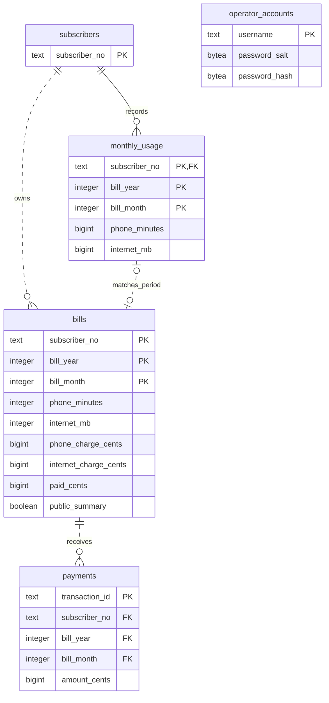

# Billing data model

- PostgreSQL enforces the foreign key from `monthly_usage.subscriber_no`
  to `subscribers.subscriber_no` and the composite foreign key from
  `payments` to the corresponding bill. `bills` identifies the subscriber
  and period at the application level. It shares those three key fields
  with `monthly_usage`.
- `monthly_usage` holds current counters. `bills` stores the usage snapshot
  and charges from the latest calculation for that period. Payment records
  have unique transaction IDs. Recording a payment and updating
  `bills.paid_cents` happen in one database transaction.
- `public_summary` marks synthetic bills that allow anonymous summary
  queries. `operator_accounts` stores salted password hashes separately
  from subscriber records. Chat keeps pending confirmations in process
  memory until use or expiry.

[Bill schema](../billing_api/db/schema.sql) ·
[Subscriber and usage schema](../billing_api/db/usage.sql) ·
[Payment and public summary schema](../billing_api/db/payments.sql) ·
[Operator account schema](../billing_api/db/operator_accounts.sql)
